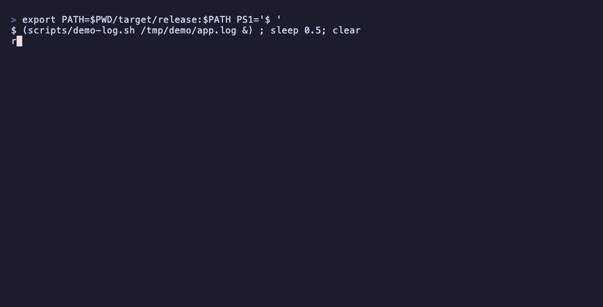

# rtail

[](https://github.com/andersonmrodrigues/tail-web/actions/workflows/ci.yml)

`tail` rewritten in Rust. It seeks backward through huge files instead of reading
them, follows files with native OS notifications (kqueue on macOS, inotify on
Linux) instead of polling, keeps up with truncation and log rotation, and can
stream the files it follows to a browser.



## Install

Download a binary for macOS (Apple silicon or Intel) or Linux x86_64 from
[Releases](https://github.com/andersonmrodrigues/tail-web/releases), or build it:

```bash
cargo install --git https://github.com/andersonmrodrigues/tail-web
```

## Usage

```bash
rtail -n 20 app.log              # last 20 lines
rtail -c 1048576 app.log         # last MiB
rtail -n +100 app.log            # from line 100 to the end
rtail -f app.log                 # follow the open file, even if it is renamed
rtail -F app.log                 # follow the name across logrotate (--follow=name --retry)
rtail -f --pid 4242 app.log      # stop when process 4242 exits
rtail -F --serve app.log db.log  # watch both files in a browser at http://127.0.0.1:8080
command | rtail -n 5             # standard input
```

Supported options, with GNU semantics and messages: `-n`/`-c` (with `+N` and
the obsolete `-N` form), `-q`, `-v`, `-f`/`--follow[=descriptor|name]`, `-F`,
`--retry`, `-s`/`--sleep-interval`, `--pid`, `--use-polling` and `--serve[=ADDR]`.
Run `rtail --help` for details.

### Web mode

`--serve` follows the files as `-f` does, but sends each line to a browser over
Server-Sent Events. The embedded viewer has one tab per file, a text or regex
filter, error and warning highlighting, pause, and auto-scroll. A browser that
connects late first gets the last 5000 lines.

It binds `127.0.0.1:8080` by default and only ever exposes the files named on
the command line. While bound to loopback it rejects requests whose `Host`
header is not this server, so a malicious web page cannot read your logs
through DNS rebinding. `--serve=0.0.0.0:8080` makes it reachable from other
machines, with no authentication, and rtail warns about that on startup.

## How it works

**Seeking to the end.** For `-n N` on a regular file, rtail reads 64 KiB blocks
backward from the end and counts newlines until it has N, then copies from that
offset. The cost depends on the size of the output, not of the file: the last
10 lines of a 2 GiB log take the same time as those of a 2 KiB one. `-c N` is a
single seek. Pipes cannot seek, so they go through a ring buffer that holds only
the lines that may still be printed. A regular file redirected to standard input
(`rtail < big.log`) is detected and seeked like any other file.

**Following without polling.** After the initial tail, rtail sleeps in
`kevent` (macOS) or `poll` on an inotify descriptor (Linux) until a followed file
changes. It calls the syscalls directly through `libc`, in about 360 lines in
[`src/watch`](src/watch). kqueue watches the open descriptor with
`EVFILT_VNODE`; inotify watches `/proc/self/fd/N`, so both stay attached to the
file itself when it is renamed. An idle `rtail -f` uses no CPU. `--use-polling`,
or a platform with neither API, falls back to checking every `-s` seconds.

**Truncation and rotation.** On every wake-up rtail compares the file's size
with its read offset; a file that shrank was truncated (`copytruncate`), so it
reports that and reads again from the start. In name mode (`-F`) it also stats
the path every `-s` seconds and compares device and inode numbers with the file
it has open. When they differ, logrotate replaced the file: rtail reads what was
left in the old one, then opens the new one from its first byte. A path that
disappears is retried until it comes back.

**Web mode.** The follow loop is the same code as in the terminal, running on
its own thread, with a different output sink. Each file has a hub holding the
recent lines and a broadcast channel; a browser subscribes under the same lock
that guards the backlog, so it gets no gap and no duplicate between the replay
and the live lines. A browser too slow to keep up is told how many lines it
missed instead of slowing the others. When following ends (all files gone, or
`--pid` exited), the channels close and the server shuts down gracefully.

## Benchmark

`scripts/bench.sh` compares rtail with the system tail using
[hyperfine](https://github.com/sharkdp/hyperfine), on a generated log file
(5 GiB by default, `scripts/bench.sh 2` for 2 GiB). The results below used a
2 GiB file because the machine was short on disk space, not the 5 GiB default.
Apple M3 with macOS 26 (BSD `tail`), warm page cache:

| Command | rtail | macOS `tail` |
|:---|---:|---:|
| `-n 10` | 2.0 ms | 1.5 ms |
| `-c 1048576` | 2.1 ms | 32.9 ms |
| `-n +2` (whole file to `/dev/null`) | 0.2 s | 66 s |

For `-n 10` both tools only read the end of the file, so the time is process
startup; rtail's binary is larger because it carries the web server, which
costs about half a millisecond. For `-c`, rtail does a single seek; for `+N`, it
skips N-1 lines and hands the rest of the file to `io::copy` in 64 KiB blocks.
These two gaps are specific to the BSD `tail` that ships with macOS; GNU `tail`
handles both cases efficiently.

The Criterion benchmarks in [`benches/reader.rs`](benches/reader.rs)
(`cargo bench`) measure the library without process startup. `-n 10` costs
the same whatever the file size:

| Benchmark | Time |
|:---|---:|
| `-n 10`, 1 MiB file | 5.3 µs |
| `-n 10`, 64 MiB file | 5.5 µs |
| `-n 10`, 256 MiB file | 5.1 µs |
| `-n +1`, 64 MiB file | 5.0 ms (12.5 GiB/s) |
| `-n 10` on a 16 MiB pipe | 3.5 ms (4.5 GiB/s) |

## Compatibility

Error messages, headers and exit codes follow GNU coreutils `tail`, and the
static output is tested byte for byte against the system `tail`. Known
differences:

- A directory operand is an error (`Is a directory`, exit 1), as in GNU tail.
  BSD tail on macOS prints nothing for it and exits 0.
- `-f` on a pipe is ignored, as in GNU tail.
- In web mode, a line is shown once its newline arrives (or once it reaches
  64 KiB, to bound memory).

## Development

```bash
cargo test                                  # unit, property and integration tests
cargo clippy --all-targets -- -D warnings
cargo bench                                 # Criterion benchmarks
scripts/bench.sh                            # comparison with the system tail
```

The integration tests drive the real binary through appends, truncation,
`mv`-and-recreate rotation, `copytruncate`, atomic replacement and deletion,
and test the web server over raw HTTP. CI runs everything on Linux (inotify) and
macOS (kqueue). The demo above is recorded from [`demo.tape`](demo.tape) by the
`Demo` workflow.

## License

[MIT](LICENSE)
